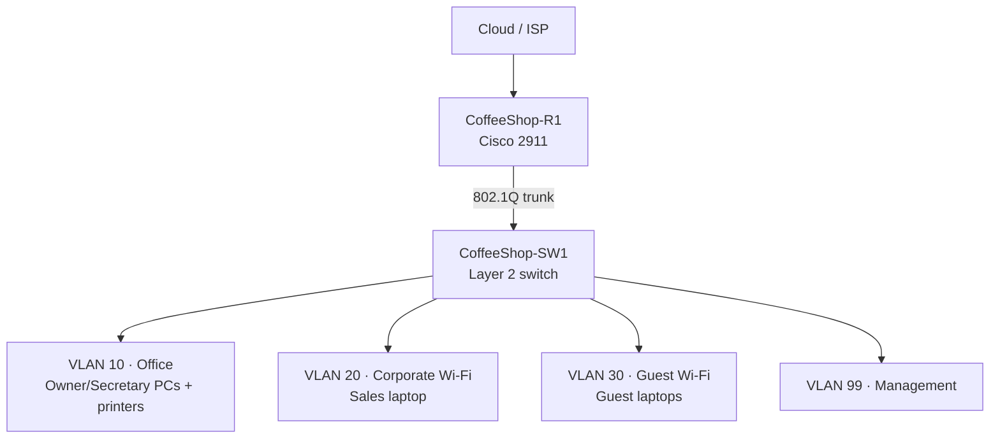

# Coffee Shop Network Lab

A Cisco Packet Tracer portfolio project that models a small coffee shop network with separate office, corporate wireless, guest wireless, and management segments.

The lab demonstrates VLAN segmentation, router-on-a-stick inter-VLAN routing, DHCP, wireless access, switch hardening, and an extended ACL that keeps guest devices away from internal business networks.

## Topology



## Network plan

| VLAN | Name | Subnet | Default gateway | Purpose |
|---:|---|---|---|---|
| 10 | OFFICE | `192.168.10.0/24` | `192.168.10.1` | Owner, secretary, and printers |
| 20 | CORP_WIFI | `192.168.20.0/24` | `192.168.20.1` | Employee wireless devices |
| 30 | GUEST_WIFI | `192.168.30.0/24` | `192.168.30.1` | Guest internet access |
| 99 | MANAGEMENT | `192.168.99.0/24` | `192.168.99.1` | Network-device management and native VLAN |

The switch management SVI is `192.168.99.2/24`. End devices receive addresses by DHCP; infrastructure and printers can use reserved/static addresses outside the client range.

## What the lab implements

- Four VLANs for traffic separation
- An 802.1Q trunk between the switch and router
- Router-on-a-stick with one subinterface per VLAN
- Separate DHCP pools for office, corporate Wi-Fi, and guest Wi-Fi
- Corporate and guest SSIDs through dedicated access points
- A guest ACL that blocks access to VLANs 10, 20, and 99 while permitting other destinations
- Basic device hardening: encrypted secrets, console authentication, MOTD banner, PortFast, and BPDU Guard
- End-to-end verification through pings, DHCP checks, VLAN/trunk inspection, and ACL counters

## Repository contents

| Path | Description |
|---|---|
| `coffee-shop-network-lab.pkt` | Cisco Packet Tracer lab file |
| `configs/router-config.txt` | Sanitized router configuration reference |
| `configs/switch-config.txt` | Sanitized switch configuration reference |
| `docs/test-plan.md` | Test procedure and expected results |
| `docs/linkedin-post.md` | Ready-to-edit LinkedIn project post |

## Open the lab

1. Install Cisco Packet Tracer 9.x or a compatible version.
2. Download or clone this repository.
3. Open `coffee-shop-network-lab.pkt`.
4. Wait for switch ports and wireless links to converge.
5. Follow the checks in `docs/test-plan.md`.

## Key verification commands

On the switch:

```text
show vlan brief
show interfaces trunk
show spanning-tree
show ip interface brief
show mac address-table
```

On the router:

```text
show ip interface brief
show ip route
show ip dhcp binding
show access-lists GUEST_RESTRICTIONS
```

## Expected security behavior

| Source | Destination | Expected |
|---|---|---|
| Office client | Office gateway | Pass |
| Corporate laptop | Corporate gateway | Pass |
| Guest laptop | Guest gateway | Pass |
| Guest laptop | Office VLAN | Block |
| Guest laptop | Corporate VLAN | Block |
| Guest laptop | Management VLAN | Block |
| Guest laptop | Allowed upstream destination | Pass when upstream routing/NAT is configured |

## Design notes

- The management SVI and VLAN 99 router subinterface must be in the same subnet. This version uses `192.168.99.2/24` on the switch and `192.168.99.1/24` on the router.
- The guest ACL must be applied inbound on `G0/1.30`; defining the ACL alone does not enforce it.
- The included `.pkt` file contains lab-only credentials. The text configurations intentionally use placeholders to model safe public-repository practices.
- Internet simulation depends on the Cloud/ISP configuration. Local VLAN and ACL tests can be completed without public internet access.

## Skills demonstrated

Cisco IOS CLI · VLANs · 802.1Q trunks · router-on-a-stick · DHCP · wireless LANs · extended ACLs · basic Layer 2 security · troubleshooting · technical documentation

## Possible next improvements

- Add NAT/PAT and a fully simulated ISP path
- Use SSH-only device administration
- Add DHCP snooping and Dynamic ARP Inspection
- Add port security and shut down unused access ports
- Add a second switch and test STP root-bridge selection and redundancy

## Author

Trevion Richardson — IT specialist and CCNA learner building practical networking projects.
